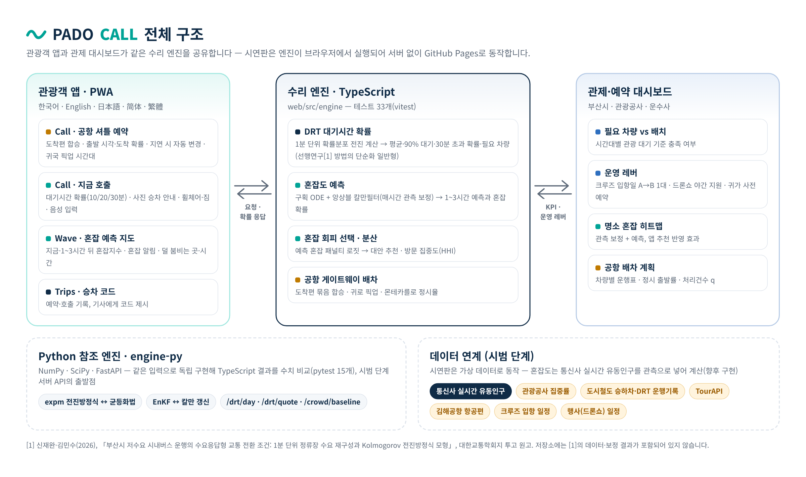
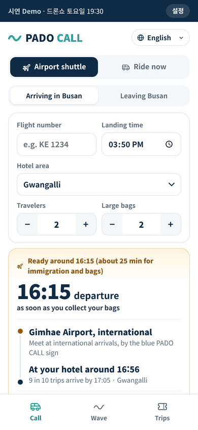
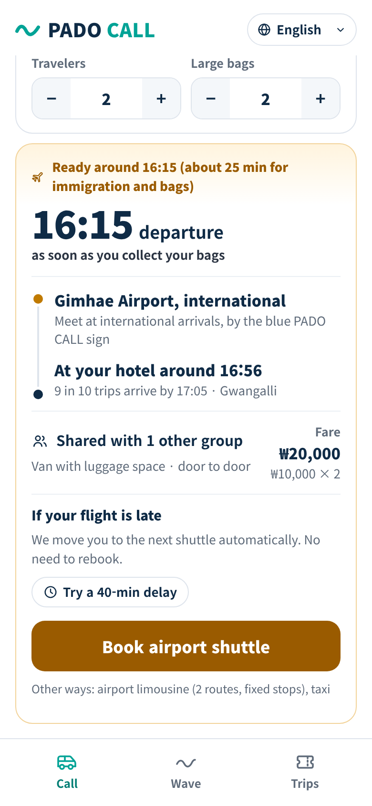
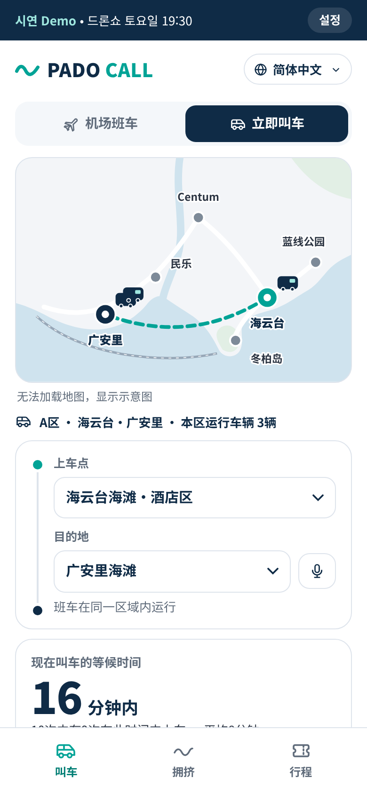
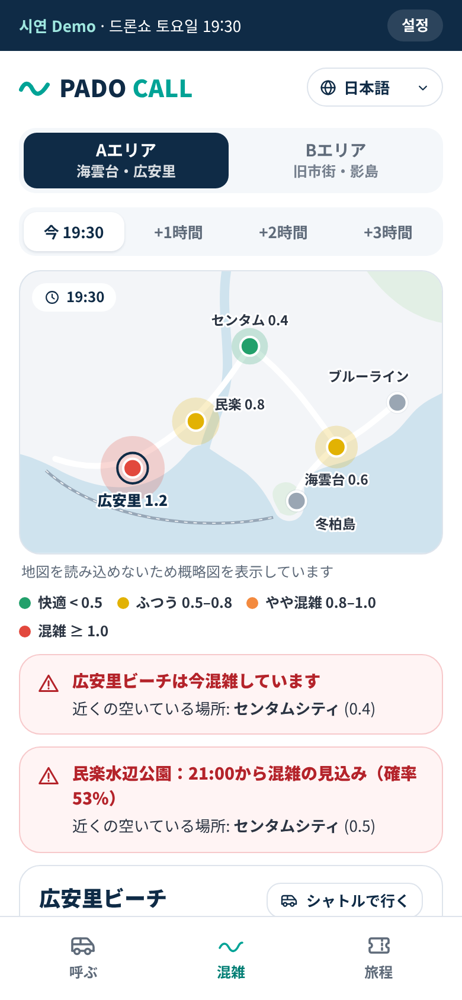
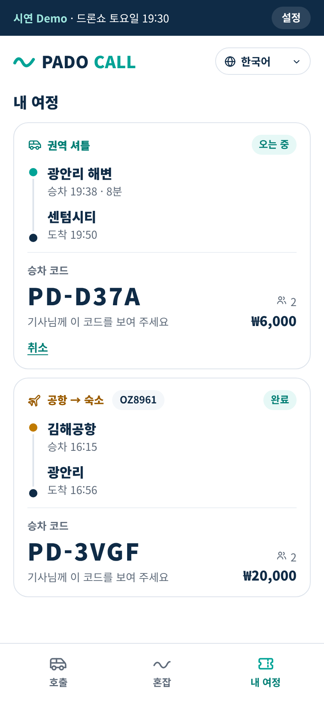
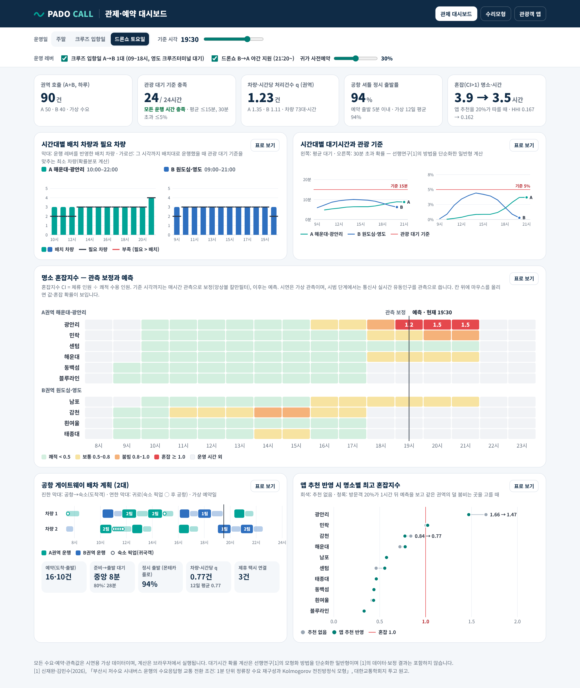

# 파도콜 PADO CALL — 공항부터 명소까지, 내 언어로 부르면 오는 관광셔틀

## 2026 글로컬 부산관광 트래블톤 출품작
#### Track 4 · 관광 인프라

### 개발 기간
- 기획: 2026.10 (아이디어 계획서)
- MVP: 2026.10 – 2026.11 (본선 시연용)

## 데모

**웹 데모: https://jaewansh.github.io/pado-call/** — PC와 휴대폰 브라우저에서 바로 열립니다. 올리는 방법과 확인 방법은 [GUIDE_GITHUB.md](GUIDE_GITHUB.md)에 정리했습니다.

| 화면 | 바로가기 |
|---|---|
| 관광객 앱 · 공항 셔틀 / 지금 호출 | [jaewansh.github.io/pado-call/#/call](https://jaewansh.github.io/pado-call/#/call) |
| 관광객 앱 · 혼잡 예측 지도 | [#/wave](https://jaewansh.github.io/pado-call/#/wave) |
| 관광객 앱 · 내 여정(승차 코드) | [#/trips](https://jaewansh.github.io/pado-call/#/trips) |
| 관제·예약 대시보드 (한국어) | [#/control](https://jaewansh.github.io/pado-call/#/control) |
| 수리모형 설명 | [#/model](https://jaewansh.github.io/pado-call/#/model) |

- 언어·시나리오를 주소로 지정할 수 있습니다: [`?lang=en#/call`](https://jaewansh.github.io/pado-call/?lang=en#/call), [`?lang=ja&day=cruise&t=1300#/wave`](https://jaewansh.github.io/pado-call/?lang=ja&day=cruise&t=1300#/wave) (lang = ko · en · ja · zhHans · zhHant, day = weekend · cruise · drone, t = 시각 HHMM)
- 휴대폰 브라우저에서 열고 **홈 화면에 추가**하면 앱처럼 실행됩니다(PWA).
- 지도는 OpenStreetMap 기반 실제 지도입니다. 발표장 인터넷이 불안정하면 주소에 `?map=schematic`을 붙여 개략도 지도로 시연할 수 있고, 지도를 불러오지 못하면 개략도로 자동 전환됩니다.
- 모든 수요·예약·관측값은 **시연용 가상 데이터**이며, 계산은 서버 없이 브라우저에서 실행됩니다.

## 프로젝트 개요

부산을 찾는 외국인 개별관광객은 버스·지하철 자체보다 **공항 첫 구간, 언어, 결제, 짐, 마지막 구간**에서 막히고, 그 막힘이 특정 명소 쏠림과 주민 불편으로 번지고 있습니다. 파도콜은 김해공항 게이트웨이(예약 합승)와 두 개의 관광 권역(A 해운대·광안리, B 원도심·영도)을 잇는 **다국어 관광 DRT**입니다. 관광객은 5개 언어로 공항 셔틀을 예약하고, 명소에서 셔틀을 부르면 **몇 분 안에 탈 확률**을 미리 보며, 혼잡 예측 지도로 덜 붐비는 곳과 시간을 고릅니다. 관제 대시보드는 같은 수리 엔진으로 시간대별 필요 차량, 크루즈 입항일·드론쇼 같은 행사일의 재배치, 공항 배차 정시율을 보여 줍니다.

## 전체 구조



## 시연



## 핵심 기능

| 공항 셔틀 예약 (English) | 지금 호출 (简体中文) | 혼잡 예측 지도 (日本語) | 내 여정 (한국어) |
|---|---|---|---|
|  |  |  |  |
| 도착편 합승 · 출발 시각과 숙소 도착 확률(중앙값·90%) · 항공편 지연 시 자동 변경 · 귀국객 숙소 픽업 시간대 | 지금 부르면 10·20·30분 안에 탈 확률 · 90% 대기 · 실제 지도 위 승차·목적지·운행 차량 · 사진 승차 안내 · 휠체어·유아차·짐 · 음성 입력 | 실제 지도 위 지금~3시간 뒤 혼잡지수 · 혼잡 알림 · 오늘 가장 한산한 시간 · 같은 권역의 덜 붐비는 곳 | 예약·호출 기록과 승차 코드 · 운행 상태 · 취소 |

> 위 화면은 지도를 불러오지 못할 때 쓰는 개략도 버전입니다. 데모 주소에서는 OpenStreetMap 실제 지도 위에 운행 권역·혼잡도·승차 위치가 표시되고, 지도 글자도 앱 언어(영·일·중)로 바뀝니다.

**관제·예약 대시보드** — 시간대별 배치 차량과 필요 차량, 관광 대기 기준(평균 ≤ 15분, 30분 초과 확률 ≤ 5%), 명소 혼잡 히트맵(관측 보정 + 예측), 공항 게이트웨이 배차표, 앱 추천 반영 시 혼잡 변화. 운영 레버(크루즈 입항일 A→B 1대 — 대형 크루즈가 정박하는 영도 국제크루즈터미널에서 대기, 드론쇼 B→A 야간 지원, 귀가 사전예약 비율)를 바꾸면 모든 지표가 다시 계산됩니다.



## 수리모형

1. **관광 DRT 대기시간 확률** — 권역에 들어온 호출 수의 확률분포를 1분 단위로 앞으로 계산해 대기시간 분포와 시간대별 필요 차량을 구합니다. 모형화 방법은 팀의 선행연구 [1]을 관광 권역용으로 단순화한 일반형이며, 수식과 보정 결과는 [1]을 인용합니다.
2. **혼잡도 예측** — 명소별 구획 모형과 앙상블 칼만필터(매시간 관측으로 체류 인원과 그날의 유입 배수를 보정). 시연판의 관측은 가상 데이터이며, **향후 통신사 실시간 유동인구**를 관측으로 넣어 혼잡도를 계산합니다(아래 '향후 구현 계획').

$$\frac{dN_a}{dt}=A_a(t)-\frac{N_a(t)}{T_a},\qquad CI_a(t)=\frac{N_a(t)}{K_a}$$

$$\mathbf{x}^{a}_{i}=\mathbf{x}^{f}_{i}+\mathbf{K}\left(\mathbf{y}+\boldsymbol{\epsilon}_i-\mathbf{H}\mathbf{x}^{f}_{i}\right),\qquad \mathbf{K}=\mathbf{P}^{f}\mathbf{H}^{\top}\left(\mathbf{H}\mathbf{P}^{f}\mathbf{H}^{\top}+\mathbf{R}\right)^{-1}$$

3. **혼잡 회피 선택 확률과 분산 효과** — 도착 시점의 예측 혼잡지수를 벌점으로 넣은 다항 로짓, 방문 집중도(HHI)

$$P_u(a\mid t)=\frac{\exp\left(V_{ua}-\theta\,\widehat{CI}_a(t+\Delta)\right)}{\sum_{b}\exp\left(V_{ub}-\theta\,\widehat{CI}_b(t+\Delta)\right)},\qquad \mathrm{HHI}(t)=\sum_{a} s_a(t)^{2}$$

4. **공항 게이트웨이 배차** — 같은 권역 도착객을 묶어 출발, 귀로에 귀국객 숙소 픽업, 이동시간 변동·항공편 지연을 몬테카를로로 뽑아 정시 출발률을 평가합니다.

자세한 설명과 모수 표는 데모의 `#/model` 화면에 있습니다.

## 향후 구현 계획 — 통신사 실시간 유동인구로 혼잡도 계산

현재 시연판은 가상 관측으로 같은 계산 흐름을 보여 줍니다. 시범 운영 단계에서는 다음과 같이 실제 데이터로 바꿉니다.

| 단계 | 내용 |
|---|---|
| 관측 데이터 | 통신사(SKT·KT 등)가 비식별 집계한 격자 단위 실시간 유동인구를 제휴로 수신 — 개인 위치는 수집하지 않음 |
| 명소별 집계 | 명소 영역(폴리곤)과 겹치는 격자 인구를 면적 비율로 합산해 관측값 $y_a(t)$ 생성 |
| 동화(EnKF) | 관측식 $y_a(t)=c\,N_a(t)+\varepsilon$ — 배율 $c$(통신사 점유율·검출률)는 앙상블 상태에 넣어 함께 추정하거나 시범 초기 현장 계수로 보정, 데이터 갱신마다 1–3시간 예측과 혼잡 확률 재계산 |
| 보조 데이터 | 관광공사 관광지 집중률 예측(30일, 상대값)·도시철도 역별 승하차 → 유입의 사전분포, 행사·크루즈 일정과 셔틀 하차 인원 → 보조 관측 |
| 상주 인구 처리 | 혼잡지수(물리적 혼잡)는 전체 인원으로 계산, 관광객 분산 효과 분석에는 같은 시간대의 평소 상주 인구 기준선을 빼서 방문 인구를 따로 추정 — 감천·흰여울처럼 주거지와 겹치는 명소에 필요 |
| 관측 오차 | 격자 크기와 명소 모양에 따라 명소별 관측 오차 $R$ 값을 다르게 설정 — 흰여울처럼 좁고 긴 명소는 크게 |
| 추진·비용 | 부산시·관광공사 협의체를 통해 통신사 데이터 제휴 확정, 유상 제휴가 일반적이므로 데이터·API 예산에서 함께 검토 |

## 기술 스택

| 분류 | 기술 |
|---|---|
| 관광객 앱·대시보드 | React 18, TypeScript, Vite, PWA(매니페스트·서비스 워커) |
| 지도 | MapLibre GL JS, OpenFreeMap 벡터 타일(OpenStreetMap 데이터, API 키 불필요), 실제 도로 경로(OSRM으로 미리 계산), 오프라인 개략도 대체 |
| 수리 엔진 | TypeScript — 브라우저에서 실행 (`web/src/engine`) |
| 참조 엔진·API | Python, NumPy, SciPy, FastAPI (`engine-py`) |
| 테스트 | Vitest 33개, pytest 15개(TypeScript 결과와 수치 교차 검증), Playwright 화면 점검 |
| 배포 | GitHub Pages — `main` 브랜치의 `/docs` 폴더 |
| 데이터(시범 단계 연계 예정) | **통신사 실시간 유동인구(혼잡도 관측)**, 관광공사 관광지 집중률 예측, 도시철도 역별 승하차, TourAPI, 김해공항 항공편, 크루즈 입항·행사 일정 |

## 핵심 구현 코드

**① 혼잡도 예측 — 앙상블 칼만필터 분석 단계** ([web/src/engine/crowd.ts](web/src/engine/crowd.ts)) · 매시간 관측으로 명소별 [체류 인원, log 유입 배수]를 보정합니다.

```ts
export function enkfUpdate(ens: number[][], y: number[], obsSd: number[], rand: () => number): number[][] {
  const E = ens.length;
  const d = ens[0].length;
  const p = y.length;
  const mean = new Array(d).fill(0);
  ens.forEach((x) => x.forEach((v, j) => (mean[j] += v / E)));
  const X = ens.map((x) => x.map((v, j) => v - mean[j]));
  const PHt = Array.from({ length: d }, () => new Array(p).fill(0));
  for (let e = 0; e < E; e++) for (let i = 0; i < d; i++) for (let j = 0; j < p; j++) PHt[i][j] += (X[e][i] * X[e][j]) / (E - 1);
  const HPHt = Array.from({ length: p }, (_, i) => Array.from({ length: p }, (_, j) => PHt[i][j] + (i === j ? obsSd[i] ** 2 : 0)));
  const innov = ens.map((x) => y.map((yi, j) => yi + obsSd[j] * normal(rand) - x[j]));
  const S = solve(HPHt, transpose(innov)); // p × E
  return ens.map((x, e) => x.map((v, i) => v + PHt[i].reduce((s, val, j) => s + val * S[j][e], 0)));
}
```

**② 혼잡 회피 선택 확률** ([web/src/engine/choice.ts](web/src/engine/choice.ts)) · 분산 효과를 계산할 때는 효용을 평소 방문 패턴(기본 유입)에 맞춰 보정해, 앱이 혼잡 예측 때문에만 방문을 옮기도록 했습니다.

```ts
export function choiceProbs(V: number[], CI: number[], theta = THETA, avail?: boolean[]): number[] {
  const u = V.map((v, i) => (avail && !avail[i] ? -Infinity : v - theta * CI[i]));
  const mx = Math.max(...u);
  const e = u.map((x) => (x === -Infinity ? 0 : Math.exp(x - mx)));
  const s = e.reduce((a, b) => a + b, 0);
  return e.map((x) => (s > 0 ? x / s : 0));
}

// dispersal(): 같은 권역 방문객 중 adoption(20%)만 예측 혼잡을 보고 다시 고름
const V = sites.map((_, j) => Math.log(Math.max(base(j, t), 1e-9)));
return (1 - adoption) * base(k, t) + adoption * tot * probsAt(t)[k];
```

**③ 공항 게이트웨이 — 귀로에 귀국객 태우기** ([web/src/engine/airport.ts](web/src/engine/airport.ts)) · 도착객을 내려 준 차량이 공항으로 돌아오는 길에, 항공편 시간창(출발 2시간 전 도착, 최대 90분 일찍)에 맞는 귀국객만 태웁니다.

```ts
function returnLeg(zone: ZoneId, inZone: number, pending: Booking[], seatsFree: number) {
  let picks: Booking[] = [];
  let seats = seatsFree;
  const cands = pending.filter((b) => b.zone === zone).sort((a, b) => deadlineOf(a) - deadlineOf(b));
  for (const b of cands) {
    if (seats < b.pax) continue;
    const trial = [...picks, b];
    const back = legBack(inZone, trial);
    if (trial.every((x) => fits(x, back))) {
      picks = trial;
      seats -= b.pax;
    }
  }
  // …
}
```

## 폴더 구조

```
pado-call/
├─ docs/            GitHub Pages가 서비스하는 빌드 결과물 (npm run build로 생성)
├─ web/             앱 소스
│  ├─ src/engine/   수리 엔진: drt · crowd · choice · airport (+ 테스트)
│  ├─ src/data/     가상 시나리오: 권역·명소·수요, 도로 경로(routes.json)
│  ├─ src/screens/  Call · Wave · Trips · 관제 대시보드 · 수리모형
│  └─ scripts/      시나리오 수치 보고서, 참조 엔진용 데이터 내보내기, 도로 경로 계산
├─ engine-py/       Python 참조 엔진, 교차 검증 테스트, FastAPI 서버
├─ .github/workflows/routes.yml  도로 경로 다시 계산 + 빌드 (Actions에서 수동 실행)
├─ image/           README 이미지
└─ GUIDE_GITHUB.md  GitHub 업로드·확인 방법
```

## 실행 방법

**웹 앱** (Node.js 18 이상)

```bash
cd web
npm install
npm run dev        # http://localhost:5173 에서 개발 서버
npm test           # 엔진 테스트
npm run build      # docs/ 폴더 갱신 (GitHub Pages 배포용)
npm run report     # 시나리오 수치 요약 (권역 q, 필요 차량, 공항 정시율, 혼잡 분산)
npm run routes     # 도로 경로 다시 계산 (인터넷 필요, 명소를 바꾼 뒤 실행)
```

지도 위 이동 경로는 명소 쌍마다 미리 계산해 `web/src/data/routes.json`에 넣어 두므로, 시연 중에는 경로 서버에 접속하지 않습니다. 명소를 추가·변경했다면 GitHub의 Actions → **road routes** → Run workflow로 경로 계산과 빌드를 한 번에 다시 할 수 있습니다.

**Python 참조 엔진** (Python 3.10 이상)

```bash
cd engine-py
pip install -r requirements.txt
pytest                                  # TypeScript 결과와 교차 검증
uvicorn padocall.api:app --reload       # http://127.0.0.1:8000/docs 에서 API 확인
```

## 데이터·인용 고지

- 차량 수·요금·수요·관측값은 기획안의 가정치와 시연용 가상 데이터입니다. 지도 위 운행 권역 경계와 승차 위치는 개략 위치입니다.
- 지도: © OpenStreetMap contributors, © OpenMapTiles, OpenFreeMap.
- 이동 경로: OSRM 자동차 경로(OpenStreetMap 도로 데이터, ODbL)를 미리 계산해 사용합니다. 셔틀 이동 시간은 이 도로 거리를 권역 평균 속도(시속 18 km)로 나눈 값에 승차 1분을 더한 가정치입니다.
- [1] 신재완·김민수(2026), 「부산시 저수요 시내버스 운행의 수요응답형 교통 전환 조건: 1분 단위 정류장 수요 재구성과 Kolmogorov 전진방정식 모형」, 대한교통학회지 투고 원고. 이 저장소에는 [1]의 데이터·보정 결과가 포함되어 있지 않습니다.

## 팀원

| 이름 | 역할 |
|---|---|
| | |
| | |
